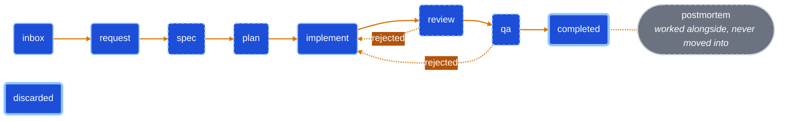

# TCW — Taxonomy · Capabilities · Work

TCW keeps three things about a software project inside the repository, next to
the code: what the project deals with, what a user can do with it, and what is
being changed. One command-line tool, `tcw`, and an agent plugin for Claude Code,
Codex, and Pi keep all three in step with the code.

| Component        | Answers                                                 |
| ---------------- | ------------------------------------------------------- |
| **Taxonomy**     | What things does this project deal with?                |
| **Capabilities** | What can a user do with those things?                   |
| **Work**         | What are we changing, and where does each change stand? |

## Contents

- [Problem Statement](#problem-statement)
- [Installation](#installation)
    - [Plugin](#plugin)
    - [CLI](#cli)
    - [Cloud Environment Instructions](#cloud-environment-instructions)
- [Overview](#overview)
- [Why taxonomy and capabilities live in the repository](#why-taxonomy-and-capabilities-live-in-the-repository)
- [Taxonomy](#taxonomy)
    - [Overview](#overview-1)
    - [Usage](#usage)
- [Capabilities](#capabilities)
    - [Overview](#overview-2)
    - [Usage](#usage-1)
- [Work](#work)
    - [Overview](#overview-3)
    - [Two backends, one model](#two-backends-one-model)
    - [Relationship to Capabilities and Taxonomy](#relationship-to-capabilities-and-taxonomy)
    - [Stages](#stages)
    - [Moving an item](#moving-an-item)
    - [Usage](#usage-2)
- [Skills and Agents](#skills-and-agents)
- [TCW Local Web App](#tcw-local-web-app)
- [Documentation](#documentation)
- [Development](#development)
    - [Setting up](#setting-up)
    - [Running the tests](#running-the-tests)
    - [How work is tracked here](#how-work-is-tracked-here)
    - [Measuring the skill layer](#measuring-the-skill-layer)
    - [Releasing](#releasing)
    - [Reporting problems](#reporting-problems)
    - [License](#license)
- [Further Reading](#further-reading)

## Problem Statement

Ask three people at a company with twenty repositories what one of those
repositories does, what a user can do with it, and what is being changed in it
right now. You get three different answers, assembled from four different places:
a ticket tracker that knows about work but not about the product, a wiki whose
glossary was last edited two years ago, a `FOLLOWUPS.md` that only grows, and
design documents that stopped matching the code some time back.

None of those places is wrong on purpose. They drift because none of them sits
next to the code, and nothing makes them move when the code moves.

TCW puts all three in the repository. One commit carries a code change and the
description of what it changed, and a reviewer sees both in the same diff.

## Installation

### Plugin

In **Claude Code**:

```
/plugin marketplace add brocef/TCW
/plugin install tcw
```

Or, in the Claude **web app** or **desktop app**, open the plugin directory, add
`brocef/TCW` as a marketplace, and install `tcw` from it — no terminal needed.

**Then start a new session.** The plugin installs the `tcw` CLI at session start
by installing `tcw-cli` from PyPI with `pipx`, so one installed mid-session
cannot run until the next one begins. That first session needs network access. It
installs over an existing `pipx install tcw-cli` rather than beside it, and
leaves a development checkout (`pip install -e .`) alone. If `tcw` goes missing
anyway, `pipx install tcw-cli` is the whole fix — the **`setup`** skill
carries the cases where it is not. When the `tcw` CLI and the plugin's skills
come from different releases, the session tells you which versions they are and
what to run to line them up; it never stops your work.

In **Codex**:

```bash
codex plugin marketplace add brocef/TCW --ref main
codex plugin add tcw@tcw
```

Codex has no session-start hook, so ask the agent to run the **`setup`**
skill — it runs the same install script Claude runs automatically. Every tcw
skill also asks the agent to run the plugin's version check once per session,
which warns when the CLI and the skills come from different releases.

In **Pi**:

```bash
pi install git:github.com/brocef/TCW
```

Add `-l` to install for the current project instead of your personal settings.
For a development checkout, use `pi install /absolute/path/to/TCW`.
Start a new Pi session, then run `/skill:setup` to install or check the `tcw`
CLI. You can also install it yourself with `pipx install tcw-cli`.
Invoke skills with `/skill:work`, `/skill:capabilities`, or `/skill:taxonomy`.

Pi loads the same skills through the official `pi` declaration in `package.json`.
It does not run TCW's Claude session-start hook or shell injections; the skills
provide explicit commands for setup, version checks, and lifecycle instructions.
Claude's custom review agents are not installed as Pi agents. When delegation
is unavailable, run ordinary lifecycle stages in the main session; autonomous
work still requires the advisors named by that workflow.
Git installation also installs the repository's Node.js package dependencies,
which support the TCW web app; local-path installation uses the checkout directly.

The plugin ships the skills and Claude Code read-only review agents described in
[Skills and Agents](#skills-and-agents).

### CLI

```sh
pipx install tcw-cli
```

Use this when you want the CLI without an agent harness at all. The PyPI package
is named **`tcw-cli`** because `tcw` was taken by an unrelated project; the
command it installs is still `tcw`.

Requires **Python ≥ 3.11** (its only runtime dependency is PyYAML); every
command, `tcw serve` included, runs on Python alone. Released wheels carry the
prebuilt web assets, so there is no frontend build step and no network needed
after install.

### Cloud Environment Instructions

A cloud agent session — Claude Code on the web, a Codex cloud task, a CI job —
starts from a clean image and is thrown away when it ends, so a `tcw` you install
by hand is gone by the next one. Install it as part of the environment's own
setup, and every session gets it without anyone remembering to.

**Claude Code on the web.** Add a script to your repository:

```sh
#!/usr/bin/env bash
# Make `tcw` available in a disposable agent container.
# Exit 0 on every path — a session must start even when this cannot finish.
set -u

command -v tcw >/dev/null 2>&1 && exit 0

# pipx where it exists; otherwise install into the container's own interpreter.
# That is the right answer *here* and nowhere else: the container is disposable
# and single-purpose, so there is no user environment to damage.
if command -v pipx >/dev/null 2>&1; then
    pipx install tcw-cli >/dev/null 2>&1 || echo "tcw: pipx install tcw-cli failed"
elif ! python3 -m pip install tcw-cli >/dev/null 2>&1 &&
    ! python3 -m pip install tcw-cli --break-system-packages >/dev/null 2>&1; then
    echo "tcw: pip install tcw-cli failed — the tcw CLI is not available."
fi

# An install that landed outside PATH is installed and unusable. $CLAUDE_ENV_FILE
# is the harness's own channel for repairing that.
if ! command -v tcw >/dev/null 2>&1 && [ -n "${CLAUDE_ENV_FILE:-}" ]; then
    userbin="$(python3 -m site --user-base 2>/dev/null)/bin"
    [ -x "$userbin/tcw" ] && echo "export PATH=\"$userbin:\$PATH\"" >>"$CLAUDE_ENV_FILE"
fi

exit 0
```

Then wire it to `SessionStart` in your repository's `.claude/settings.json`:

```json
{
    "hooks": {
        "SessionStart": [
            {
                "hooks": [
                    {
                        "type": "command",
                        "command": "\"${CLAUDE_PROJECT_DIR}\"/scripts/tcw_session_setup.sh"
                    }
                ]
            }
        ]
    }
}
```

Three things make the difference between a hook that helps and one that wastes a
session:

- **Exit 0 on every path, and print only on failure.** A hook that fails the
  session start over a missing CLI has cost more than the CLI was worth.
- **Print to stdout.** Claude Code adds a `SessionStart` hook's stdout to the
  agent's context, where it will be read; stderr becomes a transcript notice
  nobody sees.
- **Check for `tcw` first.** The hook runs every session, including the ones
  where a previous install is still there.

**Codex cloud.** A Codex cloud environment does not read a hook from your
repository. Its install steps go in the environment's **setup script**, which you
set in the environment's settings. Two things differ from Claude Code:

- **The setup script has internet access; the agent does not, by default.**
  Install `tcw` in the setup script, not by asking the agent to do it later.
- **The setup script runs in its own shell**, so an `export` there never reaches
  the agent. Repair `PATH` by writing to `~/.bashrc` instead.

```sh
if ! command -v tcw >/dev/null 2>&1; then
    if command -v pipx >/dev/null 2>&1; then
        pipx install tcw-cli
    else
        python3 -m pip install tcw-cli || python3 -m pip install tcw-cli --break-system-packages
    fi
fi

# An install that landed outside PATH: make the agent's shell find it.
userbin="$(python3 -m site --user-base 2>/dev/null)/bin"
if ! command -v tcw >/dev/null 2>&1 && [ -x "$userbin/tcw" ]; then
    echo "export PATH=\"$userbin:\$PATH\"" >>~/.bashrc
fi
```

**If your work store lives in another repository**, the container holds only the
repository it cloned, so its work items are declared but absent. Run `tcw provision`
after the install — it obtains what the checkout does not have, and does nothing
on a machine that already holds it. See
[Working across repositories](docs/guide/multi-repo.md).

Installing the **plugin** in a Claude Code session is a separate step from
installing the CLI, and only needed where the harness does not carry your plugins
in: append `claude plugin marketplace add brocef/TCW` and
`claude plugin install tcw@tcw` to the same script, guarded on `command -v claude`.

## Overview

TCW describes a project along three axes. **Taxonomy** is the project's
vocabulary and its features. **Capabilities** are the things a user can do,
each with a status. **Work** is the set of changes being made, each moving through
a series of stages. The three link by one-directional pointers: a capability
names the taxonomy entries it involves, and a work item names the capabilities
it changes. None of them copies another's content.

Taxonomy and capabilities are plain files in the repository, so a code change
and the description of what it changed travel in the same commit and the same
pull request. A work item is a **folder that never moves**: its stage is a
property recorded about it (a value, not a location), and its documents stay in
the same folder from the first stage to the last. Each item is addressed by its
**slug**, `project/folder`, such as `my-app/2026-09-15-export-invoices-as-pdf`.

**One command-line tool, `tcw`**, does everything:

| Command                   | What it does                                                                  |
| ------------------------- | ----------------------------------------------------------------------------- |
| `tcw init`                | marks a folder as a TCW project and creates the folders for each axis         |
| `tcw provision`           | obtains the stores and projects this project declares but this machine lacks |
| `tcw validate [--remote]` | checks every file, reference and link in the project; in a Jira-mode project the item references, stages and declared record changes are checked only with `--remote`, which also checks the Jira workflow |
| `tcw projects list`       | lists this project and every project connected to it                          |
| `tcw config show`         | prints the configuration commands run with; `--origin` says where each value came from |
| `tcw serve`               | starts a local web app for reading and editing all three axes                 |
| `tcw taxonomy`            | the vocabulary and features                                                   |
| `tcw capabilities`        | what a user can do                                                            |
| `tcw work`                | the changes, and the stages each one moves through                            |

A repository adopts TCW with one command:

```sh
tcw init --id my-project                # all three axes
tcw init --id my-project taxonomy work  # …or only some of them
```

That writes a `tcw-config.yaml` holding the project's ID and creates the folders
under `docs/`. A project can adopt the work axis alone and add the others later.
`tcw validate` exits non-zero on any error, so it works as a check in CI. What
every command prints, and its exit codes, are in
[the command-line guide](docs/guide/cli.md).

**The CLI enforces the rules; the agent plugin supplies the judgment.** Which
stage moves are allowed, references that must resolve, and the checks before an
item can be completed are enforced by `tcw` itself. Deciding what a request
means, writing a spec, or judging whether work is finished is what the plugin's
skills guide an agent through. See [Skills and Agents](#skills-and-agents).

**Many repositories, one model.** Projects are identified by ID, never by path.
A project lists the projects it is connected to under `projects` in its
`tcw-config.yaml`, as its `parent`, its `children`, or an `upstream` it reads.
It can inherit their taxonomy and capabilities, and address their work items as
`<project-id>/<folder>`. A parent and child each declare the other; an
`upstream` connection is declared only by the reader and is read-only from its
side, so a private project can read a public one that never names it. A
checkout holding only some of the connected repositories still works: a command
that needs an absent project says so and names `tcw provision`. See
[Working across repositories](docs/guide/multi-repo.md).

## Why taxonomy and capabilities live in the repository

The product's description, its vocabulary, its features and what its users can
do, changes in the same commit as the code that changes it. A reviewer sees both
in one diff, and the `implement` stage is where the description is changed, by
whoever writes the code.

Because the description is files in the repository, any commit shows the
product as it was at that moment. Anyone can read it, with nothing more than a
file viewer, at any point in the project's history.

That also means documentation could be generated from the records: for example,
a knowledge base that updates with every change and lets a reader pick any
point in time to see the product as it was then. TCW does not do this today; the
records are kept in a form that would allow it.

Tickets describe changes, and are short-lived; the records describe the product,
and last. So the records are never stored in Jira, whichever backend a project
uses for its work items.

## Taxonomy

### Overview

A taxonomy entry has one of two kinds. **Vocabulary** entries are the project's
basic language: `Invoice`, `Customer`, `Permission`. **Feature** entries are the
user- or application-facing parts that operate on that vocabulary, and each names
the vocabulary entries it involves. A feature can only name vocabulary that
already exists, so vocabulary is registered first.

Entries form a tree, and an entry's path is its address: `admin/permission` and
`billing/permission` are two different entries.

A project can **inherit** another project's taxonomy. Inherited entries keep the
other project's ID as a prefix, so an inherited `acme/permission` never quietly
becomes your own `permission`.

### Usage

#### Skills

| Skill                                  | What it does                                                                                              |
| -------------------------------------- | --------------------------------------------------------------------------------------------------------- |
| [`taxonomy`](skills/taxonomy/SKILL.md) | Guides an agent through declaring vocabulary and features, linking them, and resolving inherited entries. |

To draft a first taxonomy from an existing codebase, use the `setup` skill
described in [Skills and Agents](#skills-and-agents).

#### CLI

| Command                    | What it does                                                          |
| -------------------------- | --------------------------------------------------------------------- |
| `tcw taxonomy list`        | prints every entry's path                                             |
| `tcw taxonomy add`         | creates a vocabulary entry or a feature; its description from standard input |
| `tcw taxonomy show`        | prints one entry                                                      |
| `tcw taxonomy path`        | prints the folder the taxonomy is stored in                           |
| `tcw taxonomy rm`          | removes a local entry nothing is nested under or refers to            |
| `tcw taxonomy search`      | searches entry names and descriptions                                 |
| `tcw taxonomy extends add` | inherits a connected project's taxonomy (`extends rm` stops)          |

Creating the taxonomy's folder is `tcw init taxonomy`, and checking it is
`tcw validate`.

```sh
echo "A bill issued to a customer." | tcw taxonomy add Invoice   # vocabulary by default
echo "Running the shop." | tcw taxonomy add Admin
tcw taxonomy add Permission --parent admin                       # → admin/permission
tcw taxonomy add "PDF Export" --kind feature --vocab invoice
tcw taxonomy list
tcw taxonomy extends add acme-shared                             # inherit another project
```

More in [Taxonomy and Capabilities](docs/guide/taxonomy-and-capabilities.md).

## Capabilities

### Overview

A capability is one thing a user can do, such as "Download an invoice as PDF".
Each is addressed by a path (`billing/invoices`), gets a stable ID when created,
and carries a **status**: `Supported`, `Partial`, `Missing`, `Blocked` or
`Omitted`. The status is what makes the list useful: it says what the product
actually does today. The `implement` stage changes the record in the same change
as the code, and `Missing` means a gap the team has acknowledged, never a plan.

Capabilities can be **inherited** from another project. A web frontend and a
mobile app that drive the same server declare their shared capabilities once, and
each **overrides** only what differs, for example marking one `Omitted` or adding
to its description. An override can be undone to go back to the inherited
version.

#### Relationship to Taxonomy

A capability points at taxonomy, never the other way. Its `Subject` field names
the vocabulary entries it involves (any number of them), and its `Feature` field
names the taxonomy feature that delivers it. TCW checks that both resolve, and
refuses to save a capability whose references do not, so a feature is
registered in the taxonomy before a capability names it.

### Usage

#### Skills

| Skill                                          | What it does                                                                                                                                                  |
| ---------------------------------------------- | ------------------------------------------------------------------------------------------------------------------------------------------------------------- |
| [`capabilities`](skills/capabilities/SKILL.md) | Guides an agent through a work item that changes what users can do: declaring the change at spec, checking it against the existing capabilities, and changing the records during implement. |

#### CLI

| Command                        | What it does                                                                     |
| ------------------------------ | -------------------------------------------------------------------------------- |
| `tcw capabilities list`        | prints every capability's path; `--status` and `--local` narrow it               |
| `tcw capabilities show`        | prints one capability                                                            |
| `tcw capabilities path`        | prints the folder capabilities are stored in                                     |
| `tcw capabilities add`         | creates a capability; its body from standard input                               |
| `tcw capabilities set`         | changes a capability's status or fields; on an inherited one, writes an override |
| `tcw capabilities reset`       | removes a local override, going back to the inherited version                    |
| `tcw capabilities rm`          | removes a local capability                                                       |
| `tcw capabilities search`      | searches names and descriptions                                                  |
| `tcw capabilities extends add` | inherits a connected project's capabilities (`extends rm` stops)                 |
| `tcw capabilities drift`       | reports inherited capabilities nobody here has ruled on, and changes finished work declared that today's records do not show |

Creating the ledger's folder is `tcw init capabilities`, and checking it is
`tcw validate`.

```sh
tcw capabilities add billing/invoices "Download an invoice as PDF" < invoices.md
tcw capabilities set billing/invoices --field "Subject=invoice" --field "Feature=pdf-export"
tcw capabilities list --status Missing
tcw capabilities set billing/invoices --status Supported
tcw capabilities extends add web-frontend                 # inherit another project
```

More in [Taxonomy and Capabilities](docs/guide/taxonomy-and-capabilities.md).

## Work

### Overview

The work axis tracks every change being made to the project: new product
behavior, changes to its internals, or changes to how the project itself runs.

- **A work item is a folder that never moves.** It is created in the work store
  (`docs/work/` unless the project says otherwise) and stays there. Inside it is
  one folder for each stage that produces something: `spec/spec.md`,
  `implement/round-1.md`, and so on.
- **Every item has the same properties**: title, stage, priority, effort,
  complexity, tags, assignee, parent and blocked-by. Tags come from a list the
  project registers (`tcw work tags`), so a typo never quietly creates a new tag.
- **An item with children is an epic.** A child names its parent; `tcw work show`
  lists an item's children, and what blocks it and what it blocks.
- **TCW never changes git state.** It writes an item's files and leaves
  committing, pulling and pushing to you; a project that wants each move
  committed adds that itself, as
  [the configuration guide's example](docs/guide/configuration.md#example-keeping-git-in-step-with-each-stage-change-something-your-project-adds)
  shows.

The full reference is [The Work component](docs/guide/work.md).

### Two backends, one model

A project keeps its work items with one of two **backends**, chosen by
`work.backend` in `tcw-config.yaml`. The model is the same in both: the same
stages, the same properties, the same item folders and the same commands. What
differs is where each fact is kept.

| Fact                                         | Filesystem                     | Jira                            |
| -------------------------------------------- | ------------------------------ | ------------------------------- |
| the request                                  | `request/request.md`           | the ticket's description        |
| the stage                                    | `item.yaml`                    | the ticket's status             |
| assignee, priority, effort, complexity, tags | `item.yaml`                    | the ticket's fields and labels  |
| parent and blocked-by                        | `item.yaml`                    | the ticket's parent and links   |
| comments                                     | `comments/` in the item folder | the ticket's comments           |
| spec, plan, rounds, handoffs                 | the item folder                | the item folder                 |
| the records it changes, `capabilities.yaml`  | the item folder                | the item folder                 |
| taxonomy and capabilities                    | the repository                 | the repository                  |

#### Filesystem: everything in the repository

With the **filesystem** backend, the default, everything about an item is a file
in your repository: its properties in `item.yaml`, its request in
`request/request.md`, each comment in `comments/`, and its documents in its
stage folders. No other service is involved, and anything you can do to a file
(review it, diff it, grep it) you can do to your work items. See
[The Work component](docs/guide/work.md).

#### Jira: what people read in Jira, the technical record in the repository

With the **Jira** backend, Jira owns everything a person outside engineering
reads or changes: the request, the status, the assignee, the estimates, the
labels and the links. The repository owns the technical record: specs, plans,
rounds and handoffs, kept in a folder per item named after the ticket's key.
Nothing is copied between the two. See [Using TCW with Jira](docs/guide/jira.md).

### Relationship to Capabilities and Taxonomy

A change to the product is followed from the first request to the records:

1. The **request** states the product changes in plain prose.
2. The item's **`capabilities.yaml`**, written at `spec`, declares them formally:
   the capability and taxonomy paths it adds, changes and removes.
3. **`implement`** changes the records, in the same change as the code.
4. The **records gate**, on any move into the stage after `implement`, checks
   that the records match the declaration.
5. **`qa`** checks the product's behavior against the request.

In filesystem mode, the agent working `qa` may record the verdict itself, unless
the project's own instructions for `qa` ask for a person to decide. When they
do, the agent still writes the round, recording the person's decision. In Jira
mode, a person accepts or rejects on the ticket.

Work reaches taxonomy through those capabilities: a new capability names the
vocabulary and feature it involves, and those entries must exist first.

### Stages



Dashed boxes are stages a project can turn off; an item then moves straight
past them. Any item can be moved to `discarded`, with a reason.

| Stage        | Purpose                                                    | Writes                                    | Can be turned off |
| ------------ | ---------------------------------------------------------- | ----------------------------------------- | ----------------- |
| `inbox`      | a raw request waits to be taken on                         | nothing                                   | no                |
| `request`    | what is asked for, and why                                 | `request/request.md` (Jira: the ticket)    | no                |
| `spec`       | what to build, with acceptance criteria                    | `spec/spec.md`, and `capabilities.yaml`   | yes               |
| `plan`       | how to build it, as ordered tasks                          | `plan/plan.md`                            | yes               |
| `implement`  | build it, and change the records                           | `implement/round-N.md`, one per attempt   | no                |
| `review`     | check the change against the spec and plan                 | `review/round-N.md`, each with a verdict  | yes               |
| `qa`         | check the product's behavior against the request           | `qa/round-N.md` (Jira: the ticket)        | yes               |
| `completed`  | finished work                                              | nothing                                   | no                |
| `discarded`  | abandoned work, with the reason                            | nothing                                   | no                |
| `postmortem` | for a finished item: which stage could first have caught a problem | `postmortem/postmortem.md`        | yes               |

A project attaches its own text to a stage's instructions, its own checks before
an item moves into a stage, and its own commands after; see
[Configuration](docs/guide/configuration.md). `tcw work lifecycle` prints the
stages with whatever the project has attached.

### Moving an item

One command moves an item: **`tcw work advance <slug>`**, to the next stage that
is turned on. From `review` or `qa`, the next stage follows the verdict: accepted
goes forward, rejected goes back to `implement`.

- `--to <stage>` names the target. Going back needs no `--force`; going
  forward past a stage that is turned on is a skip, and needs `--force`.
  Reopening a `completed` or `discarded` item needs a `--reason`, and so does
  leaving `qa` in a Jira-mode project.
- `--force --reason "<why>"` moves the item even when a check refuses, and
  records the reason, and what it was forced past, as a comment on the item.
- `--dry-run` says where the item would go, and moves nothing.
- `tcw work discard <slug> --reason "<why>"` abandons an item, from any stage.
- **Gates** are checks that must pass first: TCW's own records gate (into the
  stage after `implement`) and completion gate (into `completed`), and a
  project's own `pre` hooks. A failing gate refuses the move and changes
  nothing.
- After the move, the target stage's **`post` hooks** run. If one fails, the move
  stands and `advance` exits with code 6.

The details are in [The Work component](docs/guide/work.md#moving-an-item).

### Usage

#### Skills

| Skill                                        | What it does                                                                                                                                                                       |
| -------------------------------------------- | ---------------------------------------------------------------------------------------------------------------------------------------------------------------------------------- |
| [`work`](skills/work/SKILL.md)               | Guides an agent through every stage of an item: deciding on an inbox arrival, writing the request, spec and plan, implementing, reviewing and testing, splitting large items, and filing work into another project. |
| [`work-create`](skills/work-create/SKILL.md) | Turns an idea for a piece of work into a work item, or adds it to the item that already covers it, after checking what is already tracked.                                          |

Most day-to-day work starts from one of the command skills (planning an item,
driving it to completion, processing the inbox) described in
[Skills and Agents](#skills-and-agents).

#### CLI

**Items**

| Command            | What it does                                                    |
| ------------------ | --------------------------------------------------------------- |
| `tcw work new`     | creates an item and prints its slug; its request from standard input; `--project` creates it in another project |
| `tcw work list`    | prints the slugs of unfinished items; `--all` adds finished ones |
| `tcw work show`    | prints an item's properties, its request and its comments       |
| `tcw work path`    | prints the work store's folder, an item's folder, or where a stage's file goes |
| `tcw work edit`    | changes an item's properties                                    |
| `tcw work comment` | adds a comment, from standard input                             |
| `tcw work rename`  | renames an item's folder                                        |
| `tcw work tags`    | lists, adds or removes the project's registered tags            |

**Moving items**

| Command            | What it does                                            |
| ------------------ | ------------------------------------------------------- |
| `tcw work advance` | moves an item to its next stage, or to the one `--to` names |
| `tcw work discard` | abandons an item, with a reason                         |

**Stage instructions**

| Command                  | What it does                                                                                               |
| ------------------------ | ---------------------------------------------------------------------------------------------------------- |
| `tcw work stage prompt`  | prints a stage's instructions, with this project's own text, for one item                                  |
| `tcw work lifecycle`     | prints every stage, whether it is turned on, and what this project attaches to it                          |
| `tcw work procedure`     | prints one of TCW's procedures, such as `unattended-work` or `search`, with this project's own text for it |
| `tcw work docs`          | prints the project's documentation entries: which documents a change must keep up to date                  |

**Jira**

| Command                 | What it does                                  |
| ----------------------- | --------------------------------------------- |
| `tcw work tickets list` | prints the Jira tickets waiting to become items |
| `tcw work tickets adopt` | makes a Jira ticket an item                  |

A session with the **filesystem** backend:

```sh
tcw work new "Export invoices as PDF" < request.md     # → my-app/2026-09-15-export-invoices-as-pdf
tcw work stage prompt spec 2026-09-15-export-invoices-as-pdf
tcw work advance 2026-09-15-export-invoices-as-pdf     # request → spec
tcw work list --stage implement
tcw work advance 2026-09-15-export-invoices-as-pdf --dry-run   # says where it would go
```

A session with the **Jira** backend:

```sh
tcw work tickets list                                   # SHOP-42
tcw work tickets adopt SHOP-42                          # → shop/SHOP-42-export-invoices-as-pdf
tcw work advance SHOP-42                                # request → spec; the ticket moves to the status set for spec
tcw work show SHOP-42
```

Every command has `--help`, and the full reference is
[The Work component](docs/guide/work.md).

## Skills and Agents

The CLI enforces the rules: which moves are allowed, which references must
resolve, what has to be true before an item completes. What a command cannot
decide (what a request really asks for, whether a spec is good enough, whether
the work is finished) is judgment, and the plugin's skills guide an agent through
it. Skills name `tcw` commands and never reimplement them, and the instructions
for each stage come from `tcw work stage prompt`, so they work the same way under
Claude Code, Codex, and Pi.

The skills for a single axis are listed in that axis's section above. These cut
across the axes.

**Setting up and configuring**

| Skill                                                      | What it does                                                                                                                                                                                  |
| ---------------------------------------------------------- | --------------------------------------------------------------------------------------------------------------------------------------------------------------------------------------------- |
| [`setup`](skills/setup/SKILL.md)                           | Gets TCW working: installs or repairs the CLI, starts using TCW in a repository, connects a project to Jira, sets up a project on a new machine, and drafts a first taxonomy or capabilities list from existing code. |
| [`configure`](skills/configure/SKILL.md)                   | Changes a working project's configuration: which stages it uses, the text and commands bound to each, the Jira backend, documentation entries, where stores live, connected and inherited projects, and personal configuration. |
| [`documentation-sync`](skills/documentation-sync/SKILL.md) | Decides which documents a finished change must update (README, changelogs, release notes, guides, skills), and runs the version cut when you ask for one.                                       |

**Command skills: the everyday workflows**

| Skill                                                                                    | What it does                                                                                                                     |
| ---------------------------------------------------------------------------------------- | -------------------------------------------------------------------------------------------------------------------------------- |
| [`commands-process-inbox`](skills/commands-process-inbox/SKILL.md)                       | Decides on every arrival in the work inbox, then writes the request for each one taken on.                                       |
| [`commands-plan-work`](skills/commands-plan-work/SKILL.md)                               | Takes an item, or a request made in chat, through the request, spec and plan stages, and stops before any code.                  |
| [`commands-drive-work-to-completion`](skills/commands-drive-work-to-completion/SKILL.md) | Takes an item from wherever it is through implement, review and qa, to completed where the agent may record the qa verdict, or to qa for a person where it may not. |
| [`commands-pause-work`](skills/commands-pause-work/SKILL.md)                             | Stops the work in hand, writes down what resuming needs in the item, and waits for you to say carry on.                          |

**Extras: optional, built for one way of working**

| Skill                                                              | What it does                                                                                                                                                                       |
| ------------------------------------------------------------------ | ---------------------------------------------------------------------------------------------------------------------------------------------------------------------------------- |
| [`extras-autonomous-work`](skills/extras-autonomous-work/SKILL.md) | Drives work items to completion unattended, asking read-only advisors wherever the lifecycle would ask you: by default Codex and a read-only subagent, replaceable by your project. |
| [`extras-triage-issues`](skills/extras-triage-issues/SKILL.md)     | Works through **your** project's GitHub issues and turns the ones worth doing into work items.                                                                                     |
| [`extras-report`](skills/extras-report/SKILL.md)                   | Files a bug report or suggestion about TCW itself on [this project's issues](https://github.com/brocef/TCW/issues).                                                                |

**Agents.** Two read-only agents ship with the plugin. Neither edits a file or
moves an item; each reports back to the session that started it.

| Agent             | What it does                                                                                                                                                         |
| ----------------- | -------------------------------------------------------------------------------------------------------------------------------------------------------------------- |
| `reviewer`        | For the `review` stage: reads an item's change against its spec, plan and `capabilities.yaml`, runs the project's checks, and recommends a verdict criterion by criterion; the session that started it writes the round. |
| `backlog-auditor` | Checks one unfinished item against your project's audit-backlog procedure, `tcw work procedure audit-backlog`, checking the item's claims against the code.          |

## TCW Local Web App

`tcw serve` starts a local web app for reading and editing the project it is run
in, as an alternative to the command line.

```sh
tcw serve              # http://127.0.0.1:8765/, and opens a browser
tcw serve --no-open    # start without opening a browser
tcw serve --port 9000  # use a different port
```

- **One Python process.** The browser client is built ahead of time and shipped
  inside the Python package, so nothing else needs to be installed, and it works
  offline.
- **What you can read.** Tabs for the work board, the taxonomy and the
  capabilities, with filters and a text search. The address bar follows the view,
  so any page can be bookmarked or shared, and any `tcw://` reference in a
  document is a link to its target.
- **What you can change.** An item's documents, rounds and handoffs, its
  `capabilities.yaml`, its properties and comments; new work items, in this
  project or in a connected one; and taxonomy entries and capabilities, created
  and edited.
- **No stage moves.** The app shows each item's stage but never changes it, and
  names the `tcw work advance` command to run instead.
- **In Jira mode**, what Jira owns (the request, comments, stage and properties)
  is shown read-only, with **Open in Jira** to change it there, and a **Tickets**
  view lists inbox tickets and adopts them.
- **One project.** The app serves the project it was started in; an item in
  another project is shown as a labelled name.
- **Local only.** The server listens only on `127.0.0.1`, and refuses requests
  that do not name a local address, which blocks other websites from making
  changes through your browser. Two people editing the same file cannot silently
  overwrite each other.

Everything else about the app is in
[The local web viewer](docs/guide/web-viewer.md).

## Documentation

| Document                                                                          | Covers                                                                                                                                       |
| --------------------------------------------------------------------------------- | -------------------------------------------------------------------------------------------------------------------------------------------- |
| [The Work component](docs/guide/work.md)                                          | Work items, their stages and folders, moving items, and every `tcw work` command, for both backends                                          |
| [Using TCW with Jira](docs/guide/jira.md)                                         | The Jira backend: who owns what, writing and following tickets, setting up, statuses, adopting tickets, QA on the ticket                     |
| [Configuration](docs/guide/configuration.md)                                      | `tcw-config.yaml`: personal configuration, stage bindings, how hooks run, documentation entries, and the opt-in git example                  |
| [The command line](docs/guide/cli.md)                                             | What every command prints on standard output and standard error, how to name an item, and the exit codes                                     |
| [Taxonomy and Capabilities](docs/guide/taxonomy-and-capabilities.md)              | Declaring vocabulary, features and capabilities, from a request to the records, drift, and inheriting both from other projects                |
| [Working across repositories](docs/guide/multi-repo.md)                           | Connecting projects, creating items in another project, keeping a store in another repository, and obtaining what a checkout does not have   |
| [Linking and validation](docs/guide/linking-and-validation.md)                    | `tcw://` references between objects, and `tcw validate` as a CI check                                                                        |
| [The local web viewer](docs/guide/web-viewer.md)                                  | Everything about `tcw serve`                                                                                                                 |
| [Configuration reference](skills/configure/SKILL.md)                              | Every configuration key, and which ones a person may override                                                                                |
| [The abstraction rules](docs/lifecycle/abstraction.md)                            | Why every operation must work for a backend that is not a filesystem, in full                                                                |
| [Release notes](docs/release-notes/)                                              | What changed for users in each version                                                                                                       |
| Migration guides                                                                  | Upgrading across a breaking release: [0.10 → 0.11](docs/migration-guide-0.10.X-to-0.11.0.md), [0.12 → 0.13](docs/migration-guide-0.12.X-to-0.13.0.md), [0.14 → 0.15](docs/migration-guide-0.14.X-to-0.15.0.md), [0.15 → 0.16](docs/migration-guide-0.15.X-to-0.16.0.md), [0.21 → 1.0](docs/migration-guide-0.21.X-to-1.0.0.md), [1.x → 2.0](docs/migration-guide-1.X-to-2.0.0.md), [2.4 → 2.5](docs/migration-guide-2.4.X-to-2.5.0.md), [2.8 → 3.0](docs/migration-guide-2.8-to-3.0.0.md) |

Every command also has `--help`.

## Development

This section is for working on TCW itself.

### Setting up

```sh
git clone https://github.com/brocef/TCW.git
cd TCW
pip install -e '.[dev]'     # or: scripts/remote_session_setup.sh --force
```

`scripts/remote_session_setup.sh` installs this checkout with its development
dependencies and installs the `tcw` plugin from the checkout. In a Claude Code
remote session it runs by itself: `.claude/settings.json` wires it to
`SessionStart`, and also enables the `tcw` plugin for this repository. It is safe
to run repeatedly and prints only when something failed. It is contributor
tooling, not the install path for users (that is `scripts/session_bootstrap.sh`,
which installs the released `tcw-cli`).

TCW does not create git worktrees. If you make one with `git worktree add`, the
editable install still runs the primary checkout's code, not the worktree's. How
to give the worktree its own environment is in
[`AGENTS.md`](AGENTS.md#working-in-a-git-worktree).

### Running the tests

```sh
pytest                  # the Python suite; what CI runs (.github/workflows/test.yml)
pnpm typecheck          # formatting check, then TypeScript
pnpm lint               # ESLint over the web app
pnpm test               # web app unit tests
pnpm test:e2e           # Playwright end-to-end tests of the web app
pnpm build              # rebuild the committed web assets
pnpm prettify           # format source and documentation
pnpm prettify:check     # check formatting without changing files
```

The `pnpm` commands need Node.js 22.12 or newer and `pnpm install` first. Python
tests build their own throwaway git repositories and never read this
repository's board.

### How work is tracked here

TCW tracks its own development with `tcw work`: every change is a work item under
`docs/work/`, and `tcw work list` shows what is in progress. The working rules for
contributors, human or agent, are in [`AGENTS.md`](AGENTS.md). This repository
adds its own instructions to three stages:
[`docs/lifecycle/abstraction.md`](docs/lifecycle/abstraction.md) at `spec` and
`plan`, [`docs/lifecycle/harness.md`](docs/lifecycle/harness.md) at `spec` and
`implement`, and [`docs/lifecycle/implementation.md`](docs/lifecycle/implementation.md)
at `implement`.

Older design history lives in [`docs/plan/`](docs/plan/) (the original designs
for each component) and [`docs/superpowers/`](docs/superpowers/); the developer
changelog for each version is in [`docs/changelogs/`](docs/changelogs/).

### Measuring the skill layer

[`evals/`](evals/) holds a harness that measures whether this project's lifecycle
instructions actually reach an agent, and what the plugin's skills add. The test
suite cannot answer that: it can prove a skill file says the right words, but not
that an agent read them. Running it starts real agent sessions and costs money;
`python -m evals.run_evals --axis a --dry-run` shows what it would run.

### Releasing

`python scripts/cut_version.py <patch|minor|major|X.Y.Z>` bumps the version in all
five files that carry it, combines the waiting changelog and release-note entries
into that version's files, commits and tags. Each change adds its entries as its
own file in `docs/changelogs/upcoming/` and `docs/release-notes/upcoming/`, named
after its work item's folder name (`<folder>.md`), so changes finished on
separate branches never edit the same file. Pushing the tag publishes the release to
PyPI. Details, including the one-time PyPI setup, are in
[`docs/releasing.md`](docs/releasing.md).

### Reporting problems

File bugs and suggestions on
[GitHub issues](https://github.com/brocef/TCW/issues). With the plugin installed,
the `extras-report` skill gives you a ready-to-fill template.

### License

Apache License 2.0; see [`LICENSE`](LICENSE).

## Further Reading

- [`AGENTS.md`](AGENTS.md): the working rules for contributing. Read it first.
- [`docs/lifecycle/abstraction.md`](docs/lifecycle/abstraction.md): the rule that
  keeps TCW's model independent of the filesystem, in full.
- [`docs/plan/`](docs/plan/): the original design documents for each component.
- `tcw work list`: what is being changed in this repository right now.
